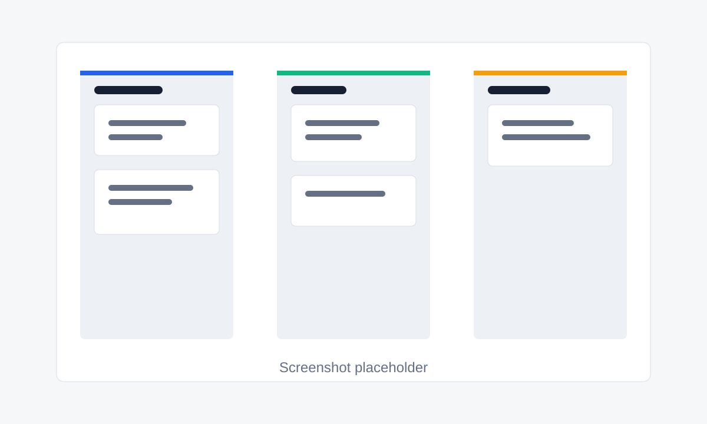

# Realtime Kanban Board




A real-time Kanban board built with Next.js App Router, Supabase Auth, Supabase Database, Supabase Realtime, TanStack Query, Zod, shadcn-style UI primitives, and dnd-kit drag and drop.

The highlight feature is realtime sync: column and card changes from another tab or collaborator invalidate the active board query and update the UI without a page refresh.

## Features

- Google OAuth with Supabase Auth
- Session-gated `/dashboard` and `/board/[id]` routes
- Create boards from the dashboard
- Add, rename, and delete columns
- Add, edit, delete, reorder, and move cards between columns
- Optimistic drag and drop updates with persisted `position` values
- Card detail modal with title, description, and due date fields
- Supabase Realtime subscriptions for board columns and cards
- Loading skeletons, empty states, and toast error notifications
- Responsive horizontal board scrolling for mobile and desktop

## Setup

1. Clone the project.

```bash
git clone <repo-url>
cd realtime-kanban-board
```

2. Install dependencies.

```bash
npm install
```

3. Create `.env` from `.env.example`.

```bash
cp .env.example .env
```

4. Add your Supabase values.

```bash
NEXT_PUBLIC_SUPABASE_URL=your-project-url
NEXT_PUBLIC_SUPABASE_ANON_KEY=your-anon-key
```

5. Run the app.

```bash
npm run dev
```

## Supabase Schema

Create these tables in Supabase and enable Realtime for `columns` and `cards`.

```sql
create table boards (
  id uuid primary key default gen_random_uuid(),
  title text not null,
  user_id uuid not null references auth.users(id) on delete cascade,
  created_at timestamptz not null default now()
);

create table columns (
  id uuid primary key default gen_random_uuid(),
  board_id uuid not null references boards(id) on delete cascade,
  title text not null,
  position integer not null default 0,
  created_at timestamptz not null default now()
);

create table cards (
  id uuid primary key default gen_random_uuid(),
  column_id uuid not null references columns(id) on delete cascade,
  title text not null,
  description text,
  due_date date,
  position integer not null default 0,
  created_at timestamptz not null default now()
);
```

## RLS Policies

Enable row level security on all tables.

```sql
alter table boards enable row level security;
alter table columns enable row level security;
alter table cards enable row level security;

create policy "Users can read own boards"
on boards for select
using (auth.uid() = user_id);

create policy "Users can insert own boards"
on boards for insert
with check (auth.uid() = user_id);

create policy "Users can update own boards"
on boards for update
using (auth.uid() = user_id)
with check (auth.uid() = user_id);

create policy "Users can delete own boards"
on boards for delete
using (auth.uid() = user_id);

create policy "Users can read own columns"
on columns for select
using (exists (select 1 from boards where boards.id = columns.board_id and boards.user_id = auth.uid()));

create policy "Users can insert own columns"
on columns for insert
with check (exists (select 1 from boards where boards.id = columns.board_id and boards.user_id = auth.uid()));

create policy "Users can update own columns"
on columns for update
using (exists (select 1 from boards where boards.id = columns.board_id and boards.user_id = auth.uid()))
with check (exists (select 1 from boards where boards.id = columns.board_id and boards.user_id = auth.uid()));

create policy "Users can delete own columns"
on columns for delete
using (exists (select 1 from boards where boards.id = columns.board_id and boards.user_id = auth.uid()));

create policy "Users can read own cards"
on cards for select
using (
  exists (
    select 1
    from columns
    join boards on boards.id = columns.board_id
    where columns.id = cards.column_id and boards.user_id = auth.uid()
  )
);

create policy "Users can insert own cards"
on cards for insert
with check (
  exists (
    select 1
    from columns
    join boards on boards.id = columns.board_id
    where columns.id = cards.column_id and boards.user_id = auth.uid()
  )
);

create policy "Users can update own cards"
on cards for update
using (
  exists (
    select 1
    from columns
    join boards on boards.id = columns.board_id
    where columns.id = cards.column_id and boards.user_id = auth.uid()
  )
)
with check (
  exists (
    select 1
    from columns
    join boards on boards.id = columns.board_id
    where columns.id = cards.column_id and boards.user_id = auth.uid()
  )
);

create policy "Users can delete own cards"
on cards for delete
using (
  exists (
    select 1
    from columns
    join boards on boards.id = columns.board_id
    where columns.id = cards.column_id and boards.user_id = auth.uid()
  )
);
```
